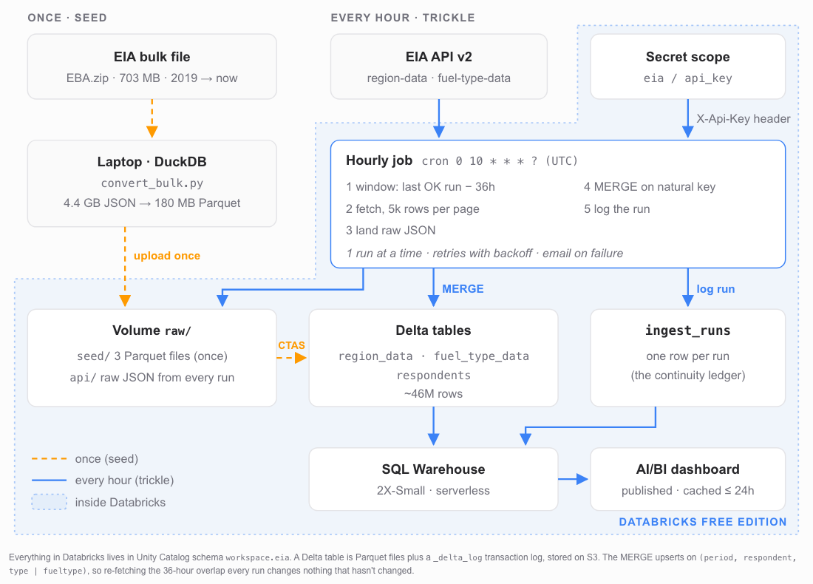
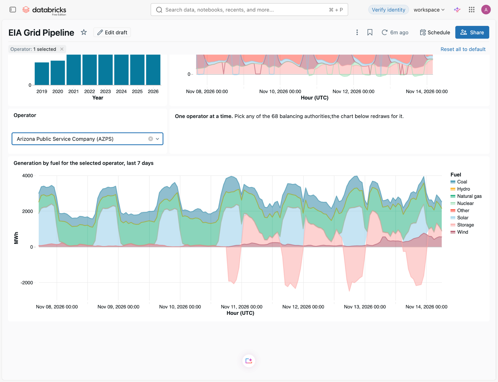

# EIA Grid Pipeline

A data pipeline for the U.S. power grid, built for BYU CS 452. It bulk-loads almost eight years of hourly grid data from the U.S. Energy Information Administration (EIA) once. It then pulls new data from the EIA API every hour, with no one touching it, and merges it into the same tables. Everything runs on **Databricks Free Edition**: a scheduled serverless job, Delta tables in Unity Catalog, and an AI/BI dashboard.

The pipeline was built with an AI coding agent (Claude Code) as part of the course's agent unit; the full conversation is submitted separately.



## What it does

| | Seed (once) | Trickle (every hour) |
|---|---|---|
| Source | EIA bulk file `EBA.zip` (703 MB zipped, 4.4 GB of JSON lines) | EIA API v2: `electricity/rto/region-data` and `electricity/rto/fuel-type-data` |
| Compute | My laptop: DuckDB (`seed/convert_bulk.py`) turned the JSON into 3 Parquet files (180 MB) | Databricks serverless job `eia-hourly-ingest`, cron `0 10 * * * ?` (every hour at :10 UTC) |
| Landing | Parquet uploaded to the Unity Catalog Volume `raw/seed/` | Each run's raw API response saved as JSON in `raw/api/` |
| Load | `CREATE TABLE … AS SELECT * FROM read_files(...)` | `MERGE` (upsert) on each table's natural key |
| Range | Jan 1, 2019 → Nov 12, 2026 (07:00 UTC for generation) | Nov 10, 2026 19:00 UTC → now (the first run overlapped the seed by 36 hours on purpose) |

**Tables** (schema `workspace.eia`, about 46.4 million rows):

| Table | One row per | Rows |
|---|---|---|
| `region_data` | hour × operator × type (D = demand, DF = demand forecast, NG = net generation, TI = total interchange) | 19.7M |
| `fuel_type_data` | hour × operator × fuel (coal, gas, nuclear, solar, wind, hydro, storage, …) | 26.7M |
| `respondents` | operator: 68 balancing authorities plus 14 regions (a region is a sum of balancing authorities) | 82 |
| `ingest_runs` | pipeline run: window, rows fetched/inserted/updated, status, error | 1 per run |

## Why each stage

- **Source: EIA Hourly Electric Grid Monitor.** It covers every U.S. grid operator hourly since 2019, has a free API, and has real lag and revision behavior to handle. Each hour I get demand, generation and generation by fuel for about 68 operators.
- **Seed on the laptop, trickle in the cloud.** The seed runs once, so it should run wherever is cheapest. Converting locally with DuckDB was free and fast, and it meant uploading 180 MB of Parquet instead of a 703 MB zip. The trickle has to run somewhere that is always on, so it's a scheduled cloud job. My laptop has not been involved since the upload.
- **Hourly cadence.** EIA publishes demand every hour, about an hour late, so hourly keeps demand fresh. Generation arrives once a day: in the raw responses, all 59 operators that report fuel data posted their new day in the same run (13:10 UTC on Nov 14). Running every hour catches that daily drop within an hour, whenever it lands. Streaming would add nothing, because the source itself updates hourly. Runs start at :10 to give EIA a few minutes after the hour.
- **Storage: Delta tables (lakehouse, OLAP), not Lakebase Postgres (OLTP).** The workload is a few huge scans and aggregations ("solar by year since 2019"), not many small transactions. That is what columnar Parquet with min/max statistics is built for. Delta adds `MERGE`, which is the whole idempotency story here.
- **Dashboard: Databricks AI/BI.** It reads the Delta tables directly through the SQL warehouse, with no extra credentials or exports. Its definition is generated by `dashboard/build_dashboard.py`, which first runs every dataset query against the warehouse so a broken query fails before it ships.

## Requirement 1: Idempotency

Every run re-fetches a window that overlaps data it already has; the window is explained under Requirement 2. Duplicates are prevented by a `MERGE` on each table's natural key:

```sql
MERGE INTO workspace.eia.fuel_type_data AS t
USING fuel_new AS s
ON  t.period = s.period AND t.respondent = s.respondent AND t.fueltype = s.fueltype
WHEN MATCHED AND t.value <> s.value THEN UPDATE SET t.value = s.value   -- EIA revised it
WHEN NOT MATCHED THEN INSERT (period, respondent, fueltype, value)
                      VALUES (s.period, s.respondent, s.fueltype, s.value)
```

- **New hour:** inserted. **Same value:** nothing written. **Changed value:** updated, because EIA revises recent numbers.
- `WHEN MATCHED AND t.value <> s.value` matters for cost. Delta rewrites whole files to update rows, so updating every re-fetched row would rewrite about 10,000 unchanged rows every hour for nothing.
- The source is deduplicated first (`dropDuplicates` on the key), because `MERGE` fails if two source rows match the same target row.
- Delta does not enforce primary keys, so the `MERGE` *is* the uniqueness guarantee.

**Evidence** (22 runs as of Nov 14, 17:39 UTC):
- 398,603 rows fetched, 38,433 inserted, 4,472 updated.
- A typical run fetches about 18,000 rows and inserts 67: one new demand hour for each reporting operator.
- Duplicate check on the natural keys of both tables: **0** duplicate keys out of 46.4 million rows.
- The dashboard's run chart shows the same thing: the "fetched" line sits far above "inserted" and "updated."

## Requirement 2: Gaps and failure handling

**The lag.** Demand arrives about 1 hour late. Generation by fuel arrives once a day, 6 to 30 hours late depending on when you look. So each run fetches from **36 hours before the last *successful* run** (`jobs/hourly_ingest.py`):

```sql
greatest( coalesce(max(started_at) of OK runs, end of seed) - INTERVAL 36 HOURS,
          current_timestamp() - INTERVAL 14 DAYS )
```

- **Normal hour:** the last good run was an hour ago, so the window is about 37 hours. That is enough to pick up the daily generation drop and any revisions.
- **Seed/trickle gap:** on the very first run there were no successful runs yet, so the window started 36 hours before the end of the seed (Nov 10 19:00 UTC). It bridged the gap and overlapped the seed. That overlap updated 1,805 values EIA had revised since the bulk file was built, and it added the storage fuel codes the bulk file leaves out (see the data-quality section).
- **API down at 3 a.m.:** each request retries 4 times with exponential backoff (5 s, 10 s, 20 s). If EIA is still down, the run records `fetch_failed` with the error in `ingest_runs`, then fails loudly. The job turns red and Databricks emails me. Nothing is lost: the next successful run measures its window from the *last successful* run, so the window stretches to cover the whole outage. **I chose backfill, not skip:** the data is still available from EIA later, re-fetching is cheap, and the idempotent `MERGE` makes overlap harmless. The cadence only decides how fresh the data is, not whether it's correct.
- **Long outages:** the window never reaches back more than 14 days, so a run after a long outage stays well inside the job's 45-minute timeout.
- **Overlapping runs:** `max_concurrent_runs = 1` with queueing, so two runs never `MERGE` the same rows at once.
- **Runs that fetch nothing new are normal.** Most runs insert 0 generation rows, because generation lands once a day. The ledger and the dashboard make that visible instead of looking like a failure.

## Requirement 3: Secrets

- The EIA API key lives only in a **Databricks secret scope** (`eia` / `api_key`). The job reads it with `dbutils.secrets.get`, and Databricks shows `[REDACTED]` if it is ever printed.
- The key is sent in the **`X-Api-Key` header, not the URL**, so it never shows up in request logs or error messages.
- The Databricks CLI authenticates with OAuth (`databricks auth login`), so there's no personal access token to leak. The `.gitignore` covers `.env`, `.databrickscfg` and the `data/` folder.
- The repo contains no credentials. The only identifiers in it are the workspace URL, IDs and my Databricks login path, and none of those are secrets.

## Requirement 4: Cost

**Actual spend: $0.** Databricks Free Edition has no billing, so there's no bill to report. It does still meter usage. The table below is from the workspace's own billing table (`system.billing.usage`), priced at Databricks' list rates (`system.billing.list_prices`), for Nov 12–14:

| Usage | Amount | List price | What it would cost |
|---|---|---|---|
| Serverless jobs (the hourly ingest) | 11.7 DBU | $0.35 / DBU | $4.11 |
| Serverless SQL warehouse (dashboard + my ad-hoc queries) | 8.9 DBU | $0.70 / DBU | $6.24 |
| Notebook (initial testing) | 0.7 DBU | $0.75 / DBU | $0.52 |
| Storage (~46M rows plus raw JSON) | 0.5 DSU | $0.023 / DSU | $0.01 |
| Other (predictive optimization, Genie) | 0.3 DBU | varies | $0.05 |
| **Total** | | | **$10.93, billed $0** |

At steady state, each run takes about 3.5 minutes, roughly 0.5 DBU. On a paid plan that would be about **$4–5 a day, or $30 a week**, for the ingest alone; storage is negligible. Most of that cost comes from the hourly cadence combined with the 36-hour window. Pulling every 3 hours would cut it to about a third and would still be correct.

The real limit on Free Edition is not money but a **daily compute quota**: if the workspace exceeds it, compute shuts off for the rest of the day. That's one reason the dashboard does not have an hourly refresh schedule. **Teardown:** after the one-week follow-up (Nov 19), I'll pause the job and drop the `workspace.eia` schema.

## The Databricks tradeoff: one platform vs. composed parts

**What it gave me.** Every stage lives in one place with one login: scheduler, compute, secret store, storage, SQL engine and dashboard. There was no glue code: no cloud function to deploy, no service account to wire between a scheduler and a warehouse, and no credentials passed between services. The only secret in the whole system is the EIA key, stored in the same platform that uses it. Unity Catalog let one `read_files` call load the seed, and Delta gave me `MERGE`, which most file-based stores don't have.

**What it took away.**
- **Hidden caches.** The dashboard keeps its own 24-hour result cache. The day after I built it, it still said "3 successful runs" while the pipeline had run 20 times. Nothing was broken; the cache just never refreshed, and the platform gives no indication that you're looking at cached results. In a composed stack I would have built that cache myself and known it was there.
- **Usage in DBUs instead of dollars.** Cost shows up in DBUs, and I had to join two system tables just to find out what a run costs.
- **Black-box compute.** I can't see or tune the serverless machines.
- **Limits I don't control.** The daily quota can stop my job for reasons unrelated to my code.
- **Vendor coupling.** The job is a Databricks notebook (`dbutils.widgets`, `dbutils.secrets`), the dashboard definition is Databricks-specific JSON, and the tables live in Unity Catalog. The SQL (`MERGE`) and the data format (Parquet) would move to another platform; the scheduling, secrets and dashboard would have to be rebuilt.

A composed pipeline (e.g. GitHub Actions → BigQuery → Looker Studio) makes every seam visible and swappable, at the cost of wiring and securing each one. For a one-person project with a free tier, the all-in-one platform was the right call, as long as I remember where its seams are hidden.

## Data-quality findings

Writing the dashboard queries turned up several problems in the data, and one in my own code:

1. **The bulk file leaves out 7 newer fuel codes** (battery storage, pumped storage, geothermal, and solar or wind paired with batteries). The API has them. So generation-by-fuel totals before Nov 10 19:00 UTC slightly undercount; California (`CISO`) was 723 MWh short in one hour I checked. Nationally it's about half a percent of generation. I **documented it rather than backfilling** 8 years from the API. The jump is easy to see for an operator like Arizona Public Service (below): storage simply doesn't exist before the seam.
2. **My code had labeled 4 regions as operators.** EIA names the single-operator regions (`NE`, `NY`, `TEN`, `TEX`) just like operators, e.g. "New York (NY)". My name-pattern test missed them, so their generation was counted twice and national generation came out **18.5% above demand**. I caught it by **reconciling two independent totals**: generation should be about 98% of demand, since the U.S. imports about 2% of its power. After switching to EIA's fixed region list, it is 98%. Every query had run without errors; only the cross-check exposed the mistake.
3. **The newest hours are always incomplete.** Not every operator has reported yet, so national sums dip at the end. Charts only use hours where at least 90% of operators have reported, and the demand chart drops the newest hour.
4. **Negative generation is real.** Batteries charge at midday when solar is abundant, which shows up as negative net generation, and they discharge in the evening. A "drop negative values" cleaning rule would have deleted real data.
5. **35 history values are physically impossible**: more than 100 GWh from one fuel at one operator in one hour, such as SPP wind at 3.59 million MWh on June 13, 2023. They're left as published and noted here; the dashboard's recent-week charts don't touch them.



## Is it alive?

- 22 runs from Nov 13 22:35 UTC to Nov 14 17:39 UTC with **0 failures**. All but the first two (my test runs) and one manual run during the demo were triggered by the schedule.
- The `ingest_runs` ledger records every run, success or failure. The dashboard's "Is it alive?" section shows minutes since the last successful run, successful runs in the last 24 hours, rows fetched vs. written per run, and how far behind each series is.
- Live data joined to history: this week's U.S. demand is plotted against the 2019–2025 average for the same date and hour. And U.S. solar for the same calendar week grew from **1,002 GWh in 2019 to 4,945 GWh in 2026 (4.9×)**.

## Repo layout

```
seed/convert_bulk.py            one-time: EBA.zip -> Parquet with DuckDB
jobs/hourly_ingest.py           the scheduled Databricks notebook (fetch -> land raw -> MERGE -> log)
jobs/eia-hourly-ingest.job.json the job's settings (schedule, retries, concurrency, alerts)
dashboard/build_dashboard.py    validates every query, then creates/updates and publishes the AI/BI dashboard
dashboard/eia_pipeline.lvdash.json  the generated dashboard definition
docs/architecture.html|png      the architecture sketch
```
